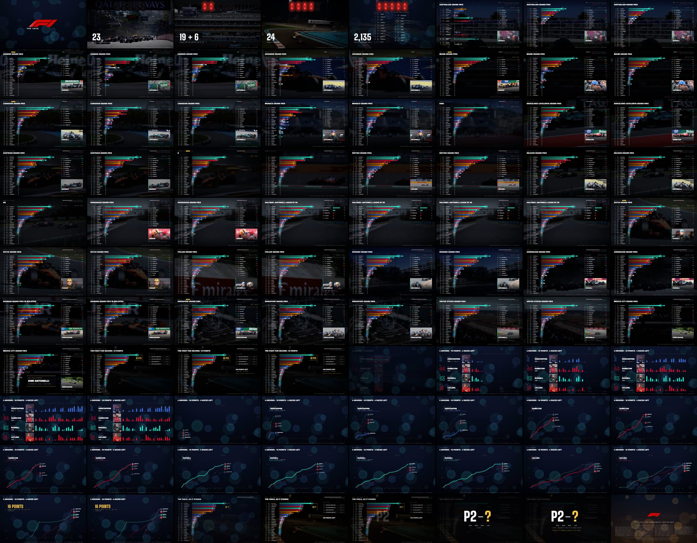
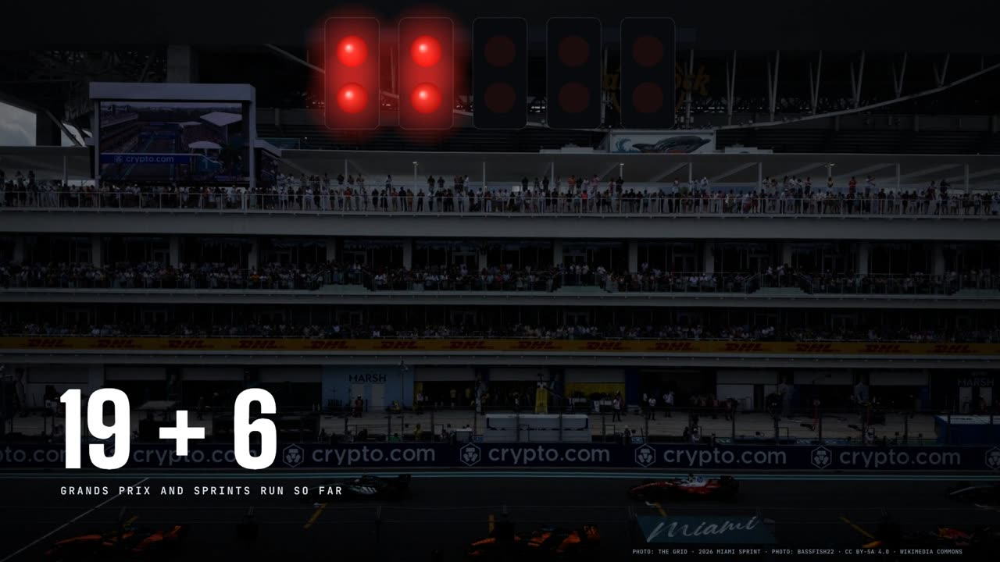
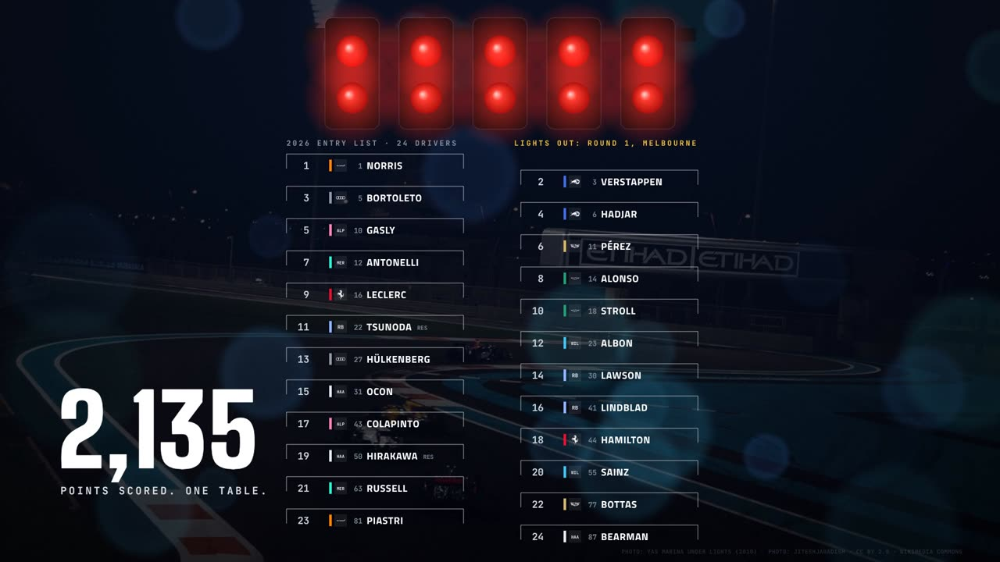
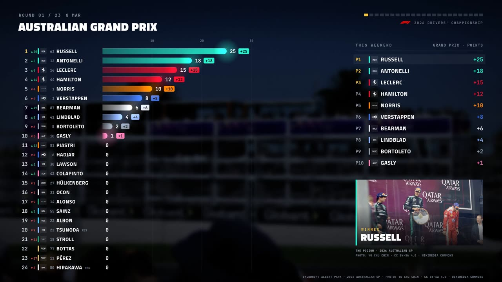
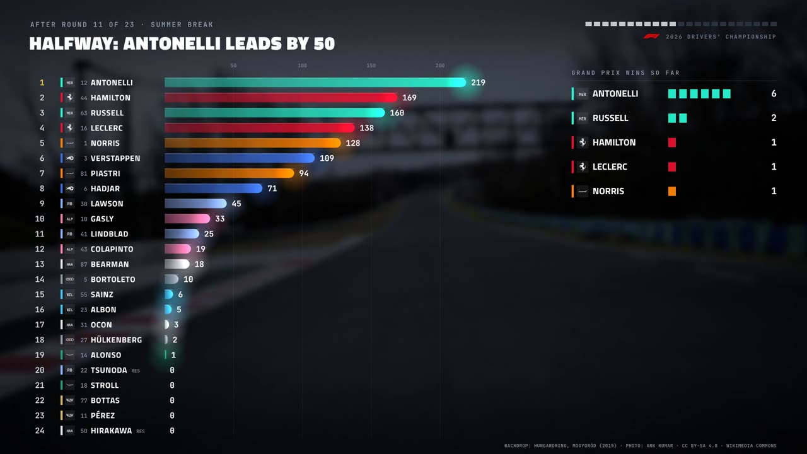
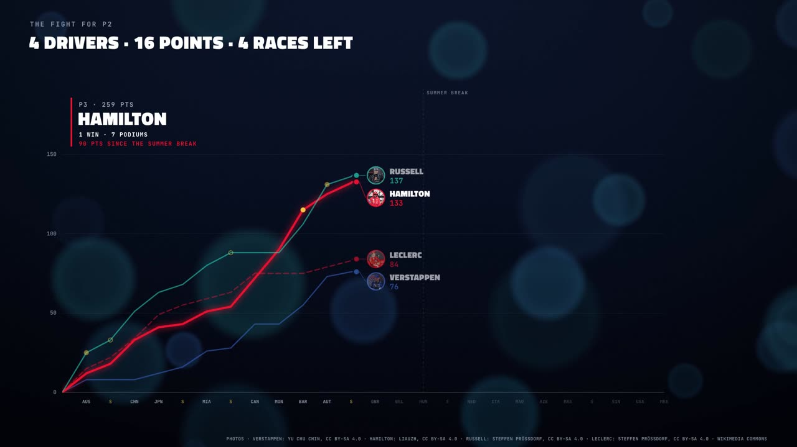
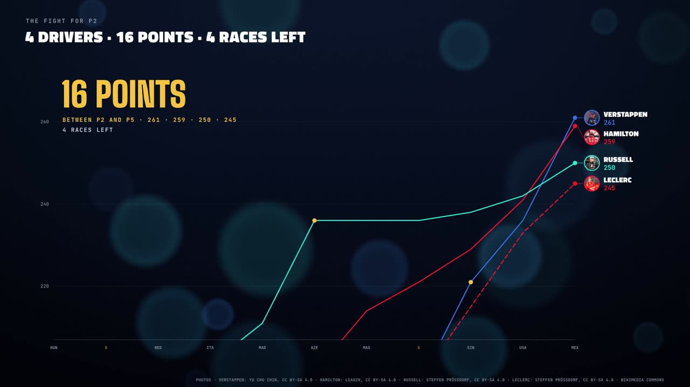

# F1 · 2026, race by race

**A music video for "F1": the 2026 Formula 1 drivers' championship as a dynamic leaderboard.** All 24 drivers re-rank round by round, from Melbourne to Mexico City, cut to the song. It ends on the fight for second place.



After 19 rounds, **Kimi Antonelli is the 2026 world champion**: he clinched the title with third place in Mexico City, on 380 points with four races to spare. Behind him, **four drivers are separated by 16 points**: Verstappen 261, Hamilton 259, Russell 250, Leclerc 245. The video shows how every one of those points was scored, race by race and sprint by sprint, and ends where the season stands: **P2 — ?**

| | |
|---|---|
| Length | 3:13.7, 1920×1080, 30 fps, H.264 + AAC 320 kbps |
| Sound | The song, with a real F1 launch recording mixed on top at lights out; the song itself is untouched |
| Data | Every points-scoring classification of 2026: 19 GPs and 6 sprints, verified against the official standings |
| Engine | TypeScript, Canvas2D leaderboard over a Three.js HDR backdrop, deterministic per frame |
| Renderer | Headless Chromium (software WebGL), parallel workers, resumable chunks, x264 |
| Analysis | Python + librosa: 110 BPM bar grid, section map, envelopes |
| Brand marks | F1 and team logos from [simple-icons](https://simpleicons.org) (CC0 path data), drawn as vectors |
| Photos | 49 photographs from Wikimedia Commons (CC0, PD, CC BY, CC BY-SA), each credited on screen; see [`CREDITS.md`](CREDITS.md) |

| | |
|---|---|
|  |  |
|  |  |
|  |  |

## The data, verified

All per-event data is in [`src/data/results.json`](src/data/results.json), with sources listed for every event. The roster, calendar and official standings are in [`src/data/season.json`](src/data/season.json). Nothing ships unless `npm test` passes these checks:

- **Per driver:** each of the 24 drivers' summed points equals the official standings after the Mexico City GP. That is 2,135 points = 19 × 101 + 6 × 36.
- **Checkpoint:** the post-Singapore totals match for the top six.
- **Constructors:** the Mercedes 630, Ferrari 504, Red Bull 380 and McLaren 365 totals match, with stand-in stints attributed correctly.
- **Points scales:** every event uses the exact scale, with no duplicate drivers.
- **Final order:** the order matches the official table, including countback on ties (Ocon, Alonso and Sainz are all on 7).

Two facts surfaced along the way:
- **Calendar.** 2026 has **23 rounds**: the Bahrain GP was re-run at Sepang, Malaysia, as Round 16.
- **Stand-ins.** Lawson raced for Red Bull, and Tsunoda for Racing Bulls, while Hadjar recovered from a wrist injury.
- **Mexico City.** Piastri finished seventh but a 10-second penalty for hitting Lindblad dropped him to 15th; the data uses the final classification. Haas ran reserve Ryo Hirakawa in place of Ocon, the season's 24th driver.

## Cut to the song

The track is instrumental: 110 BPM in D minor, turning to D major in the outro. Its structure carries the season:

| Bars | Music | Video |
|---|---|---|
| 1–5 | swell | cold open: the F1 mark, real photos cut on the downbeats, a full-width start-light gantry filling one pod per half bar (silent, as at a real start), all 24 drivers on the grid |
| 6 | bass drop | **lights out**: a Ferrari F60 launches on the drop as the grid slots launch into the table, **Round 1, Australia** |
| 6–36 | verse, hook | rounds 1–11 and their sprints; every round starts on a downbeat |
| 36–40 | the dip | **summer break**: the table holds |
| 40–58 | hook | rounds 12–19, Zandvoort to Mexico City; Antonelli clinches the title in bar 57 |
| 58–61 | | **today**: Antonelli champion, the P2 fight bracketed, 4 rounds left |
| 61–67 | breakdown | **the fight for P2**: every score of the four contenders, as strips |
| 67–83 | breakdown | **cumulative points, replayed**: four racing lines, one event per half bar, a card per bass pulse, then a zoom to the finish (261 · 259 · 250 · 245) |
| 83–end | D major | the table as it stands, a gold backdrop, **P2 — ?** |

There's no camera shake and no beat-pumped flashing. Sync comes from timing: each round lands on its downbeat, the bars grow, and then the rows re-sort. Full reasoning is in [`docs/creative-brief.md`](docs/creative-brief.md).

## How it works

```
analysis/analyze_audio.py ─► src/data/audio.json        bar grid, sections, envelopes
src/data/results.json ─────► leaderboard/model.ts       tables after every event, countback ranks
                             leaderboard/schedule.ts    events → bars; stateAt(t): points, row positions, deltas
                             leaderboard/Board.ts       rows, bars, chips, arrows (Canvas2D)
                             leaderboard/Panels.ts      header, round strip, weekend panel, start lights
                             leaderboard/logos.ts       F1 mark and team tiles (simple-icons paths)
analysis/fetch_commons.py ─► src/data/photos.json       curated Commons photos, licence-checked, with credits
analysis/mix_sfx.py ───────► public/audio/f1_sfx.m4a    launch recording at lights out, mixed onto the song
                             photos/{PhotoPlate,venues,credits}.ts   venue backdrop, winner card, on-screen credits
                             scenes/{Intro,Season,P2Fight,Outro}.ts   one act per section group
engine/Compositor.ts ──────► HDR backdrop + overlay → frame (pure function of song time)
scripts/render.mjs ────────► N headless Chromium workers → JPEG → x264 chunks → concat → mux the soundtrack
```

- **Deterministic.** Every frame is a pure function of song time, so frames render in any order across parallel workers and land exactly on the beat grid. Frames are sampled at the middle of their display interval.
- **Grid anchoring.** The drums are syncopated, so onset trackers lock onto the off-beat. The bar grid is anchored on the structural hit into the verse and verified independently: the breakdown hit lands **3 ms** from bar 61, and harmonic change concentrates on beats 1 and 3.

### History

The first version was a cinematic 3D race: procedural 2026 cars, the Yas Marina gridshell, and light trails. It was retired after review (geometry clipping, distracting camera shake, and the wrong subject) in favour of this data-first cut. It remains in git history at commit `560d4f4`.

## Run it

```bash
npm install
python3 -m venv analysis/.venv && analysis/.venv/bin/pip install -r analysis/requirements.txt

# Put the song at public/audio/f1.m4a (not committed), then:
npm run analyze                 # → src/data/audio.json
analysis/.venv/bin/python analysis/fetch_commons.py   # photos + credits (already committed)
npm run sfx                     # → public/audio/f1_sfx.m4a: the song + start-light effects
npm test                        # data integrity, schedule, timeline
npm run dev                     # real-time preview with audio (?bar=40 to jump)

npm run stills -- --bars 7.6,38.6,59.6,69.6 --w 1920 --h 1080
npm run render -- --workers 3 --msaa 4                  # full 1080p30 render, with the effects
npm run render -- --audio public/audio/f1.m4a --out out/F1_MV_2026_1080p_music_only.mp4 --no-build   # music only: re-muxes, no re-render
analysis/.venv/bin/python analysis/verify_av.py out/F1_MV_2026_1080p.mp4
```

**After the next race:**
1. Append its classification to `results.json`.
2. Update `officialStandings`, `afterRound` and `remaining` in `season.json`, and set `championDecided` once settled.
3. Give the new round a slot in `schedule.ts`.

`npm test` will refuse data that doesn't add up.

## Photographs

Real photos come from [Wikimedia Commons](https://commons.wikimedia.org). Only files Commons marks as CC0, public domain, CC BY or CC BY-SA are used, and each is credited on screen while it is shown.

- **Behind the board:** each round's venue, from that 2026 weekend wherever Commons has it, and often showing the race winner's car (Antonelli at Suzuka, Leclerc at Silverstone, Norris at Zandvoort…). It dissolves in on the round's downbeat and is softened, darkened and graded so the numbers always read.
- **Winner card:** the winner of each Grand Prix and sprint, under the weekend's classification, in a photo of their own: 24 events, 24 different photos. For 10 events (Australia, both Chinese races, Japan, Austria, both Silverstone races, both Zandvoort races, and the Bahrain GP) the photo is from that very weekend. For the other 14, Commons has no free photo of the winner there yet, so the card shows the winner at another 2026 event, and its caption says which.
- **P2 fight:** a portrait of each of the four contenders, in their blocks and at the heads of the points chart.
- **Finale venue:** Yas Marina under lights, from "today" to the gold ending.

Who a photo shows comes from its Commons title, description and categories. Captions state where and when each photo was taken.

[`analysis/photos.select.json`](analysis/photos.select.json) is the curated list. `analysis/fetch_commons.py` checks each file's licence against Commons metadata, downloads a resized copy, and writes the manifest and [`CREDITS.md`](CREDITS.md). `npm test` checks that every photo has an accepted licence, an author, a source page and a credits entry. It also checks that every race winner and every P2 contender has a photo.

**Licence of the video:** some photos are CC BY-SA, so the rendered video is shared under [CC BY-SA 4.0](https://creativecommons.org/licenses/by-sa/4.0/). The code is unaffected.

## Sound effects

The countdown's sound is mixed onto the song by [`analysis/mix_sfx.py`](analysis/mix_sfx.py):

- **No beeps.** Real F1 start lights make no sound; what you hear at a race is the engines. Nothing synthetic is added while the lamps light: the song carries the countdown.
- **The launch.** At lights out a real Formula 1 car pulls away: a [Ferrari F60 (2009) at the Goodwood Festival of Speed 2010](https://commons.wikimedia.org/wiki/File:Ferrari_F60_(2009).ogg), recorded by Edvvc (CC BY-SA 3.0). It's trimmed to the launch, high-passed at 120 Hz so the song's bass drop keeps the low end, and faded out into the verse. The recording is credited on screen while it plays and on the closing card.

**The song is never processed:** no ducking, no limiter, no EQ. The recording is only added on top. Where it plays, the mix peaks at −3.7 dBFS, well clear of clipping.

**Sync comes from the picture.** The cue bars live in [`src/data/sfx.json`](src/data/sfx.json), which the video's gantry also reads. The launch starts on the first dark frame.

`verify_av.py` checks this from the rendered file:
- it reads the lamps from the frames, finds the launch in the audio, and checks that nothing is added while the lamps light;
- it measures that the song outside the recording matches the original, up to the one re-encode needed to mix (residual about 32 dB below the music);
- for a music-only cut, it confirms the soundtrack is the source stream, byte for byte.

## Brand marks

The F1 logo sits in the header and on the title card, and every driver row carries a team tile. The marks are drawn as vectors from [simple-icons](https://simpleicons.org) 16.36.0, whose SVG path data is CC0. The marks themselves remain trademarks of their owners and appear here only to identify each team. That set covers F1, Ferrari, McLaren, Red Bull, Aston Martin, Audi and Cadillac. Mercedes, Williams, Haas, Alpine and Racing Bulls aren't in it, so their tiles show a short code (MER, WIL, HAA, ALP, RB) rather than a borrowed or non-free logo. Stand-in rounds show the team the driver raced for: Lawson carries the Red Bull mark at Zandvoort, Monza and Madrid. `tests/assets.test.ts` checks that every team, stand-in teams included, has a mark or a code.

*Unofficial fan work, not affiliated with or endorsed by Formula 1, the FIA or any team. Logos and trademarks belong to their owners and are used for identification only.*
