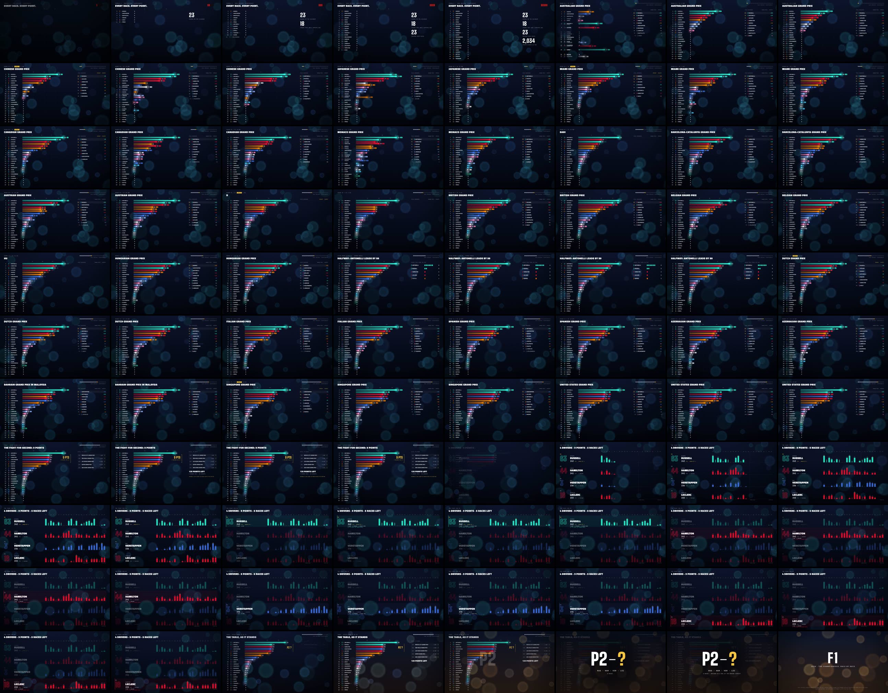
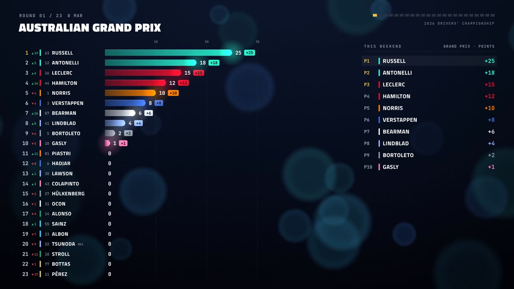
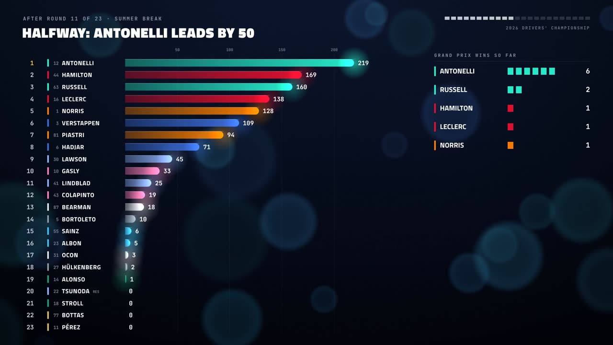
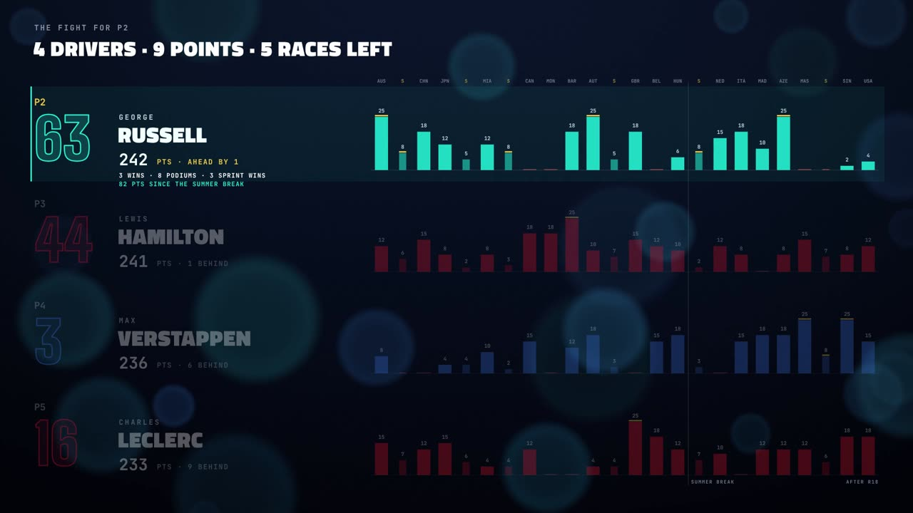
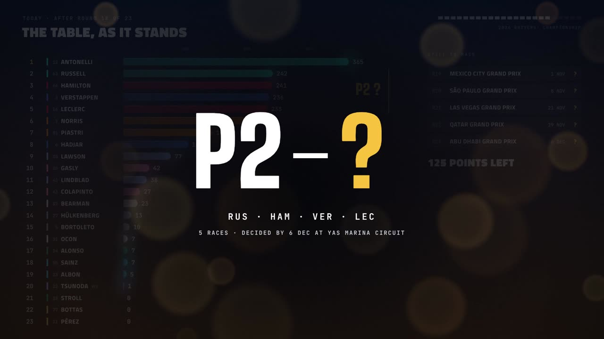

# F1 · 2026, race by race

**A music video for "F1": the 2026 Formula 1 drivers' championship as a dynamic leaderboard.** All 23 drivers re-rank round by round, from Melbourne to Austin, cut to the song. It ends on the fight for second place.



After 18 rounds, Kimi Antonelli has 365 points and the title all but won. Behind him, **four drivers are separated by 9 points**: Russell 242, Hamilton 241, Verstappen 236, Leclerc 233. The video shows how every one of those points was scored, race by race and sprint by sprint, and ends where the season stands: **P2 — ?**

| | |
|---|---|
| Length | 3:13.7, 1920×1080, 30 fps, H.264 + the original AAC stream (copied, not re-encoded) |
| Data | Every points-scoring classification of 2026: 18 GPs and 6 sprints, verified against the official standings |
| Engine | TypeScript, Canvas2D leaderboard over a Three.js HDR backdrop, deterministic per frame |
| Renderer | Headless Chromium (software WebGL), parallel workers, resumable chunks, x264 |
| Analysis | Python + librosa: 110 BPM bar grid, section map, envelopes |

| | |
|---|---|
|  |  |
|  |  |

## The data, verified

All per-event data is in [`src/data/results.json`](src/data/results.json), with sources listed for every event. The roster, calendar and official standings are in [`src/data/season.json`](src/data/season.json). Nothing ships unless `npm test` passes these checks:

- **Per driver:** each of the 23 drivers' summed points equals the official standings after the United States GP. That is 2,034 points = 18 × 101 + 6 × 36.
- **Checkpoint:** the post-Singapore totals match for the top six.
- **Constructors:** the Mercedes 607, Ferrari 474, McLaren 355 and Red Bull 355 totals match, with stand-in stints attributed correctly.
- **Points scales:** every event uses the exact scale, with no duplicate drivers.
- **Final order:** the order matches the official table, including countback on ties (Ocon, Alonso and Sainz are all on 7).

Two facts surfaced along the way:
- **Calendar.** 2026 has **23 rounds**: the Bahrain GP was re-run at Sepang, Malaysia, as Round 16.
- **Stand-ins.** Lawson raced for Red Bull, and Tsunoda for Racing Bulls, while Hadjar recovered from a wrist injury.

## Cut to the song

The track is instrumental: 110 BPM in D minor, turning to D major in the outro. Its structure carries the season:

| Bars | Music | Video |
|---|---|---|
| 1–5 | swell | 23 drivers on zero; five start lights, one per bar |
| 6 | bass drop | lights out: **Round 1, Australia** |
| 6–36 | verse, hook | rounds 1–11 and their sprints; every round starts on a downbeat |
| 36–40 | the dip | **summer break**: the table holds |
| 40–57 | hook | rounds 12–18, Zandvoort to Austin |
| 57–61 | | **today**: the P2 fight bracketed, 5 rounds left |
| 61–82 | breakdown | **the fight for P2**: every score of the four contenders, one driver per bass pulse |
| 83–end | D major | the table as it stands, a gold backdrop, **P2 — ?** |

There's no camera shake and no beat-pumped flashing. Sync comes from timing: each round lands on its downbeat, the bars grow, and then the rows re-sort. Full reasoning is in [`docs/creative-brief.md`](docs/creative-brief.md).

## How it works

```
analysis/analyze_audio.py ─► src/data/audio.json        bar grid, sections, envelopes
src/data/results.json ─────► leaderboard/model.ts       tables after every event, countback ranks
                             leaderboard/schedule.ts    events → bars; stateAt(t): points, row positions, deltas
                             leaderboard/Board.ts       rows, bars, chips, arrows (Canvas2D)
                             leaderboard/Panels.ts      header, round strip, weekend panel, start lights
                             scenes/{Intro,Season,P2Fight,Outro}.ts   one act per section group
engine/Compositor.ts ──────► HDR backdrop + overlay → frame (pure function of song time)
scripts/render.mjs ────────► N headless Chromium workers → JPEG → x264 chunks → concat → mux original audio
```

- **Deterministic.** Every frame is a pure function of song time, so frames render in any order across parallel workers and land exactly on the beat grid. Frames are sampled at the middle of their display interval.
- **Grid anchoring.** The drums are syncopated, so onset trackers lock onto the off-beat. The bar grid is anchored on the structural hit into the verse and verified independently: the breakdown hit lands **3 ms** from bar 61, and harmonic change concentrates on beats 1 and 3.

### History

The first version was a cinematic 3D race: procedural 2026 cars, the Yas Marina gridshell, and light trails. It was retired after review (geometry clipping, distracting camera shake, and the wrong subject) in favour of this data-first cut. It remains in git history at commit `560d4f4`.

## Run it

```bash
npm install
python3 -m venv analysis/.venv && analysis/.venv/bin/pip install -r analysis/requirements.txt

# Put the song at public/audio/f1.m4a (not committed), then:
npm run analyze                 # → src/data/audio.json
npm test                        # data integrity, schedule, timeline
npm run dev                     # real-time preview with audio (?bar=40 to jump)

npm run stills -- --bars 7.6,38.6,59.6,69.6 --w 1920 --h 1080
npm run render -- --workers 3 --msaa 4                  # full 1080p30 render
analysis/.venv/bin/python analysis/verify_av.py out/F1_MV_2026_1080p.mp4
```

**After the next race:**
1. Append its classification to `results.json`.
2. Update `officialStandings`, `afterRound` and `remaining` in `season.json`, and set `championDecided` once settled.
3. Give the new round a slot in `schedule.ts`.

`npm test` will refuse data that doesn't add up.

*Unofficial fan work. Not affiliated with Formula 1, the FIA or any team. No logos or likenesses are used; team colours are team-inspired.*
